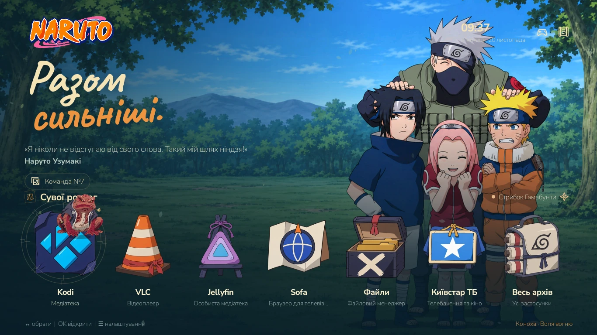
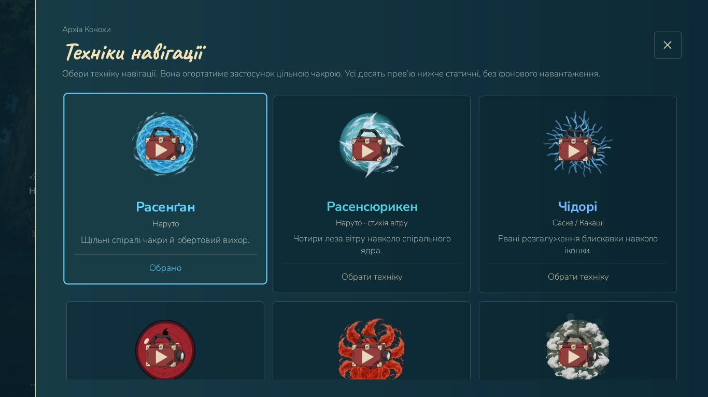
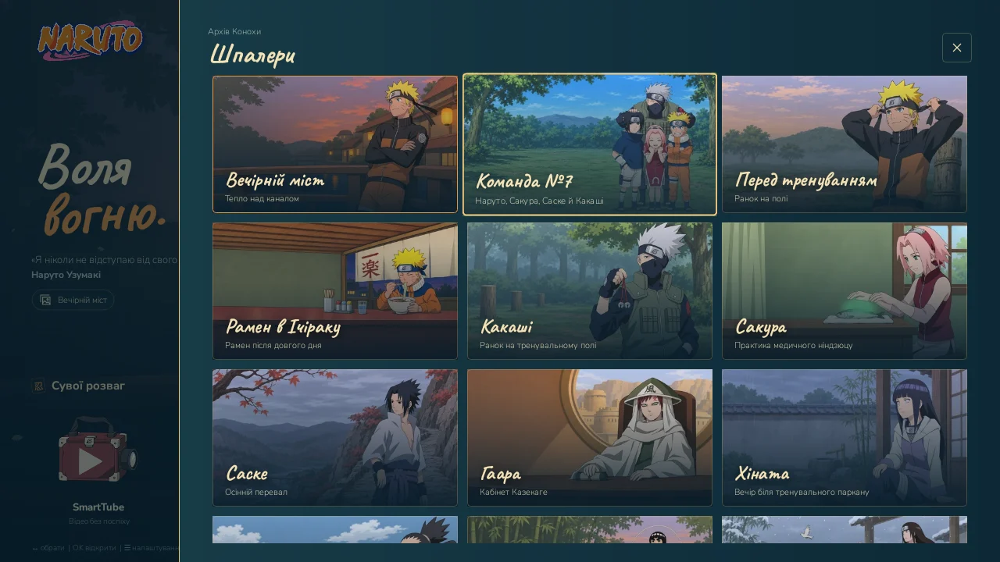
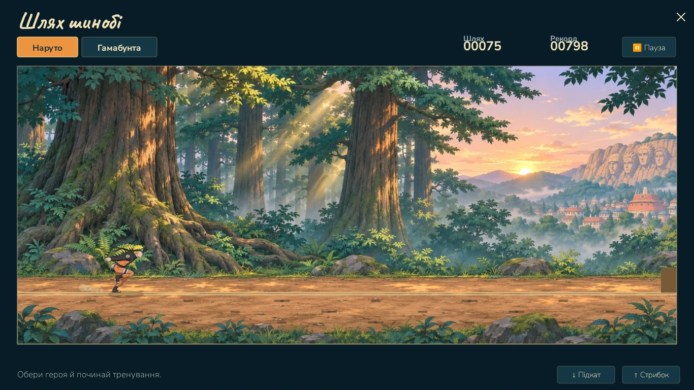

<h1 align="center">Naruto · Коноха</h1>

<p align="center">
  <strong>Фанатський лаунчер у світі Naruto для Android TV і Google TV</strong><br>
  Улюблені застосунки, сцени Конохи та анімована навігація пультом.
</p>

<p align="center">
  <a href="https://github.com/oktirus/NarutoLauncher/releases/download/v1.1.6/KonohaNative-1.1.6.apk"><strong>Завантажити APK 1.1.6</strong></a>
  · <a href="https://github.com/oktirus/NarutoLauncher/releases/latest">Останній реліз</a>
  · <a href="#встановлення">Встановлення</a>
  · <a href="#кнопка-home">Кнопка Home</a>
</p>

## Відео з Lenovo

https://github.com/user-attachments/assets/30e8571c-037a-4ab1-beed-c613dc52b6a9

**00:00** Стрибок Гамабунти · **00:11** Вибір техніки · **00:18** Шарінґан · **00:24** Галерея шпалер · **00:30** Ґаара · **00:33** Налаштування

Один безперервний запис із Lenovo на LineageOS, демонстраційна збірка 1.1.4. Усі дії виконано стрілками, **OK**, **Menu** і **Back**. Увімкни звук у плеєрі, щоб почути фонову музику від початку й звуки навігації.

## Можливості

- **Обране й архів.** Перші шість обраних застосунків видно на головному екрані. В архіві можна шукати встановлені застосунки, фільтрувати обране й змінювати його порядок.
- **Керування пультом.** Стрілки переміщують фокус, **OK** відкриває, а довге **OK** показує меню картки.
- **18 сцен і 10 технік навігації.** Можна змінювати шпалери, ефект фокусу, декоративні анімації та гучність.
- **Режим спокою та «Шлях шинобі».** Після бездіяльності можна показувати годинник і цитату. З головного екрана відкривається мінігра за Наруто або Гамабунту.
- **Home й оновлення.** Коноху можна обрати домашнім екраном. Для Google TV є перенаправлення після **Home**, а нові версії завантажуються з GitHub через лаунчер.

## Скриншоти

| Головний екран | Техніки навігації |
| --- | --- |
| [](docs/media/konoha-home.webp) | [](docs/media/konoha-techniques.webp) |

| Галерея сцен | Мінігра «Шлях шинобі» |
| --- | --- |
| [](docs/media/konoha-scenes.webp) | [](docs/media/konoha-game.webp) |

## Встановлення

Потрібен телевізор або приставка з **Android TV чи Google TV на Android 8.0 або новішому**.

1. Завантаж `KonohaNative-*.apk` зі сторінки [останнього релізу](https://github.com/oktirus/NarutoLauncher/releases/latest).
2. Скопіюй APK на USB-накопичувач, підключи його до телевізора й відкрий файл у файловому менеджері на ТБ.
3. Якщо Android попросить дозвіл, дозволь встановлення з цього файлового менеджера й повернися до APK.
4. Натисни **Встановити → Відкрити**. У списку застосунків лаунчер має назву **Naruto · Коноха · Native**.

<details>
<summary>Встановлення з комп’ютера через ADB</summary>

На телевізорі має бути ввімкнене налагодження. Підключи пристрій, знайди його ідентифікатор і вкажи завантажений файл.

```powershell
adb devices -l
adb -s "TV_DEVICE_ID" install -r ".\KonohaNative-1.1.6.apk"
```

Параметр `-r` оновлює сумісну версію з тим самим підписом і зберігає її дані. [Документація ADB](https://developer.android.com/tools/adb)

</details>

## Кнопка Home

1. Під час першого запуску натисни **Обрати** або відкрий **Шлях ніндзя → Домашній екран → Основний лаунчер**.
2. У системному списку вибери **Naruto · Коноха · Native**. Якщо є варіант **Завжди**, обери його.
3. Натисни **Back**, щоб повернутися до Конохи. Відкрий інший застосунок і перевір **Home** на пульті.

<details>
<summary>Якщо Home відкриває штатний Google TV</summary>

1. У лаунчері відкрий **Шлях ніндзя → Домашній екран → Коноха після Home → Відкрити налаштування**.
2. У **Спеціальних можливостях** увімкни **Коноха після Home**. Повернися в лаунчер і натисни **Перевірити**.
3. З іншого застосунку натисни **Home** на пульті. Google TV може коротко з’явитися, поки служба повертає до Конохи.

Щоб повернути штатну поведінку, вимкни службу в **Спеціальних можливостях** і обери Google TV у системному меню домашнього екрана.

</details>

## Налаштування й оновлення

- **Налаштування.** Значок сувою або **Menu** на пульті відкриває **Шлях ніндзя**. Техніки, рух і ротація сцен зібрані у **Вигляді**. У **Звук і музика** можна ввімкнути плавну автоматичну зміну треків. **Тиха мить** відкривається з першого рівня меню.
- **CPU та RAM.** У **Шлях ніндзя → Про Коноху та ресурси** можна ввімкнути показ завантаження CPU та використання RAM процесом лаунчера.
- **Шпалери.** Натисни назву поточної сцени на головному екрані, щоб відкрити галерею.
- **Оновлення.** Відкрий **Шлях ніндзя → Про Коноху та ресурси → Оновлення Конохи**. Якщо доступна нова версія, натисни **Завантажити → Встановити** й підтвердь дію в Android. [Як працюють оновлення](docs/UPDATES.md)

## Розробка й авторство

Нативний застосунок використовує Android Views і Custom Canvas. [Інструкція зі збірки](native-parity/README.md) · [Повідомити про проблему](https://github.com/oktirus/NarutoLauncher/issues) · [План розвитку](docs/ROADMAP.md) · [Шаблон README](docs/README-template.md)

Розробник — **Oktirus**. Це фанатський проєкт. Права на оригінальні матеріали Naruto належать їхнім правовласникам. [Ліцензія використаних компонентів CleanYourTV](LICENSE-cleanyourtv)
